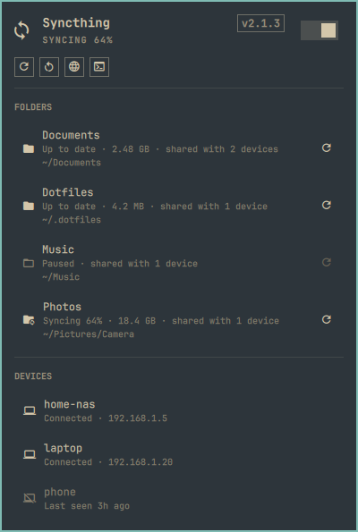

# Syncthing for Omarchy

An [Omarchy](https://omarchy.org) shell plugin that puts [Syncthing](https://syncthing.net)
in the bar: sync state at a glance, your folders and devices, service controls,
and one-click access to the web UI or a terminal UI.



## Features

- **Bar icon** that reflects the overall state: up to date, syncing, scanning,
  no devices connected (dimmed), stopped, or a folder that needs attention (urgent color).
  Hover for a summary.
- **Start / stop** with the switch in the panel header, and **restart** from the action row.
  These act on the `syncthing.service` systemd user unit.
- **Folders**: label, state (including sync progress), size, how many devices
  it is shared with, and its path. Click a folder to open it; rescan a single
  folder from its row, or **rescan all** from the action row.
- **Devices**: connected or last-seen time, address, and completion while a
  device is catching up.
- **Web UI** opens as an Omarchy web app (or a browser tab), focusing the
  existing window if it is already open.
- **TUI**: runs a command of your choice in a terminal (for example `stc`), or
  follows the Syncthing service log if none is set.

## Install

```sh
omarchy plugin add https://github.com/phil-a/omarchy-syncthing.git --enable
```

Or from a checkout:

```sh
scripts/dev-sync.sh --enable --section right
```

The plugin lands disabled until you enable it (`--enable` above, or
`omarchy plugin enable syncthing-status.widget --section right`).

### Dependencies

- [Syncthing](https://syncthing.net) running locally with its GUI/REST API
  enabled (the default), normally as the `syncthing.service` systemd user unit
- `python3` (standard library only)
- Optional: a Syncthing TUI such as `stc` (AUR) for the TUI button

## Remove

```sh
omarchy plugin remove syncthing-status.widget
```

This disables the widget and deletes
`~/.config/omarchy/plugins/syncthing-status.widget/` (a copy installed
with `scripts/dev-sync.sh` has no `.git`, so it is moved to a backup instead).
It does not touch Syncthing, its configuration, or your synced folders.

## Usage

| Where | Action | Result |
|---|---|---|
| Bar icon | Left click | Open the panel |
| Bar icon | Middle click | Rescan all folders |
| Bar icon | Right click | Open the web UI |
| Panel | `↑` `↓` `←` `→`, `Enter` | Move between the switch, actions, and folders; activate |
| Panel | `s` | Rescan all folders |
| Panel | `w` | Open the web UI |
| Panel | `t` | Open the TUI |
| Panel | `Esc` | Close |

### IPC

```sh
omarchy-shell syncthing-status.widget status   # "Up to date", "Syncing 42%", "Stopped", …
omarchy-shell syncthing-status.widget toggle   # open/close the panel
omarchy-shell syncthing-status.widget start|stop|restart
omarchy-shell syncthing-status.widget rescan
omarchy-shell syncthing-status.widget webui|tui
```

## Settings

Edit them from the bar's widget settings, or under this widget's entry in
`~/.config/omarchy/shell.json`.

| Key | Default | Meaning |
|---|---|---|
| `refreshIntervalSec` | `15` | Poll interval while idle. The widget polls every 2 s while the panel is open or something is syncing. |
| `serviceUnit` | `syncthing.service` | systemd **user** unit for start/stop/restart. |
| `webUiMode` | `Web app` | `Web app` or `Browser tab`. |
| `tuiCommand` | *(empty)* | Command to run in a terminal, e.g. `stc`. Empty follows the service log. |
| `configPath` | *(empty)* | Path to Syncthing's `config.xml`. Found automatically in `~/.local/state/syncthing` or `~/.config/syncthing`. |

## How it works

`syncthing.py` reads the API key and GUI address from Syncthing's own
`config.xml` and queries the local REST API (`/rest/system/status`,
`/rest/db/status`, `/rest/system/connections`, …) in one short-lived process
per poll. It only ever talks to the address in that config. If the GUI uses TLS,
certificate verification is skipped, because the certificate is Syncthing's
self-signed one. Service control goes straight to `systemctl --user`.

`Model.js` holds the pure state logic shared by the panel and the tests.

### Security

- The API key never leaves the machine: requests go only to the GUI address
  in Syncthing's config, bypass any `http_proxy`/`https_proxy`, and refuse
  redirects, so the key can't be forwarded elsewhere.
- Names, labels and errors that remote peers can influence are shown as plain
  text, passed to processes only as separate arguments (never through a shell),
  and folder IDs can't be mistaken for command options.
- The configured unit name must be a plain `*.service` name before it reaches
  `systemctl`.
- `tuiCommand` is run with `bash -c` by design; it comes from your own settings.
- Like every Omarchy plugin, this runs unsandboxed inside `omarchy-shell`.
  Read the code before enabling it.

## Development

```sh
scripts/dev-sync.sh             # copy into ~/.config/omarchy/plugins, validate, rescan
scripts/dev-sync.sh --restart   # ...and restart the shell (needed for Panel.qml changes)
node --test test/model.test.js  # unit tests for Model.js
python3 -m unittest discover -s test -p 'helper_test.py'  # helper tests against a fake API
python3 syncthing.py status | jq   # inspect what the panel sees
```

## License

MIT
